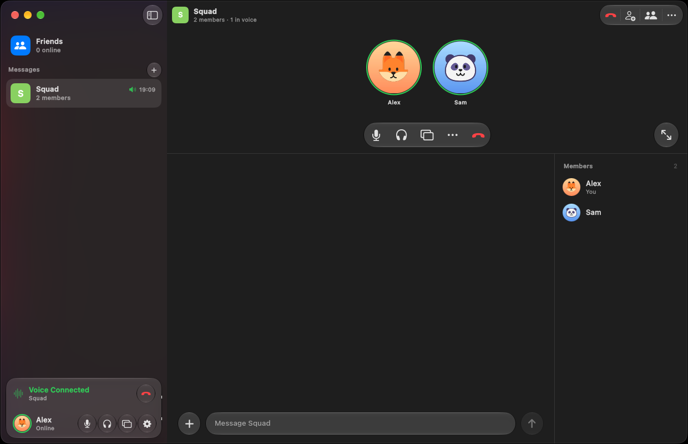
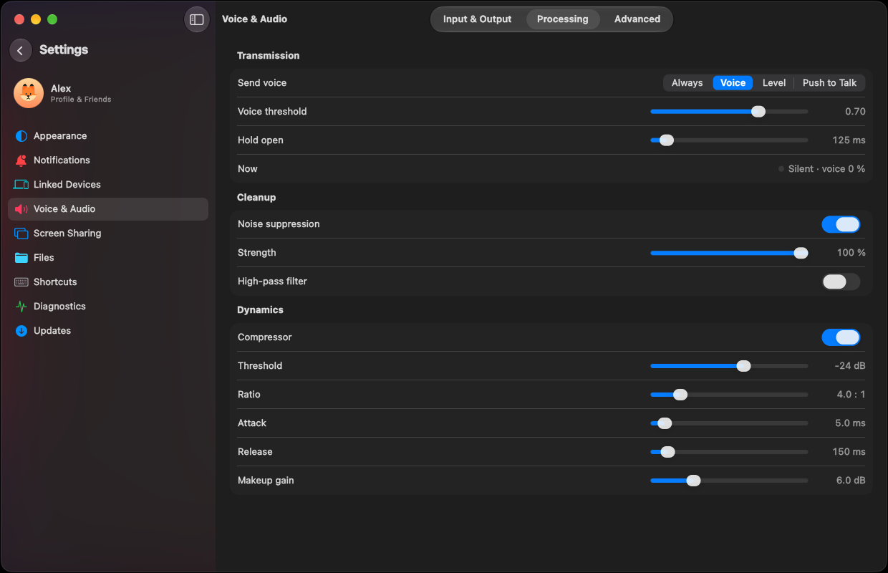
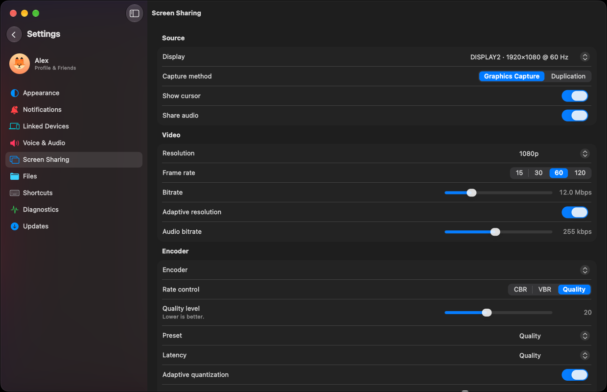
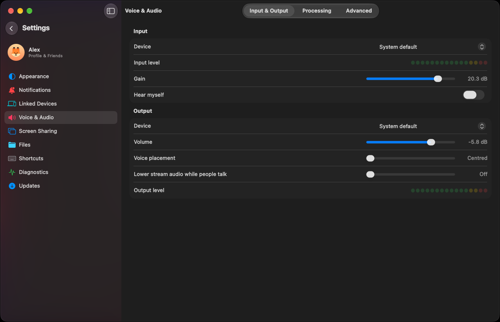

# keetv2

Peer-to-peer voice chat, messaging, file sharing and screen sharing for Windows, with a native
macOS-style interface. There are no servers and no accounts to sign up for. Everything is set up
for low latency and can be adjusted.

## Why

- **Voice with the lowest latency we can get.** Opus in its low-delay mode with 10 ms frames (or
  uncompressed PCM), WASAPI at the audio engine's minimum period and a small adaptive jitter
  buffer. The target is about 55–90 ms mouth to ear on a good direct link. Browser-based voice
  (WebRTC) typically adds 20 ms frames and a 40–80 ms jitter buffer on top of that. Bitrate goes
  up to 510 kbps and quality is never capped.
- **Screen sharing on your GPU.** NVENC, AMF or Quick Sync, using H.264, HEVC or AV1, at up to
  120 fps, with forward error correction for lost packets. You choose the encoder, rate control,
  bitrate and latency, and you can watch live stats while you stream.
- **Peer to peer, encrypted, no server.** Peers find each other on the Holepunch DHT and connect
  directly. Every connection is encrypted end to end. Your account is a key kept on your own
  devices and backed up as a 24-word recovery phrase. There is no password, and no keetv2 server
  stores your messages or calls.
- **Feels familiar.** If you have used Discord, you already know your way around: groups and
  friends in the sidebar, voice controls at the bottom, the call above the chat, and per-person
  volume.
- **Looks like a Mac app.** The interface is built on MacUIKit, our own Qt Quick reimplementation
  of macOS controls, SF Symbols and Liquid Glass. It runs on Windows with Direct3D 11.

| | |
|---|---|
|  |  |
| Every stage of voice processing is a setting: voice activation, noise suppression and the compressor. | Screen sharing: capture method, frame rate, bitrate, encoder and rate control. |

## Install

Download `keetv2-desktop-win-Setup.exe` from the [latest release](../../releases/latest) and run
it. It installs for your user only, without administrator rights. Installed copies update
themselves: a new release downloads in the background and is applied the next time keetv2
restarts.

Windows 10 or 11, x64.

## Why the source is closed

keetv2 is a personal project, and its source stays private so that it is not scraped to train AI
models. This repository holds only the release builds and the workflow that makes them.

## How releases are built

The workflow here runs only by hand. It checks out the private keetv2 and MacUIKit repositories
with read-only deploy keys, builds on a GitHub-hosted Windows runner, checks that the staged app
starts and runs its packaged worker, and uploads the Velopack release (`Setup.exe`, full and delta
packages, `releases.win.json`) as a draft or a published release.
